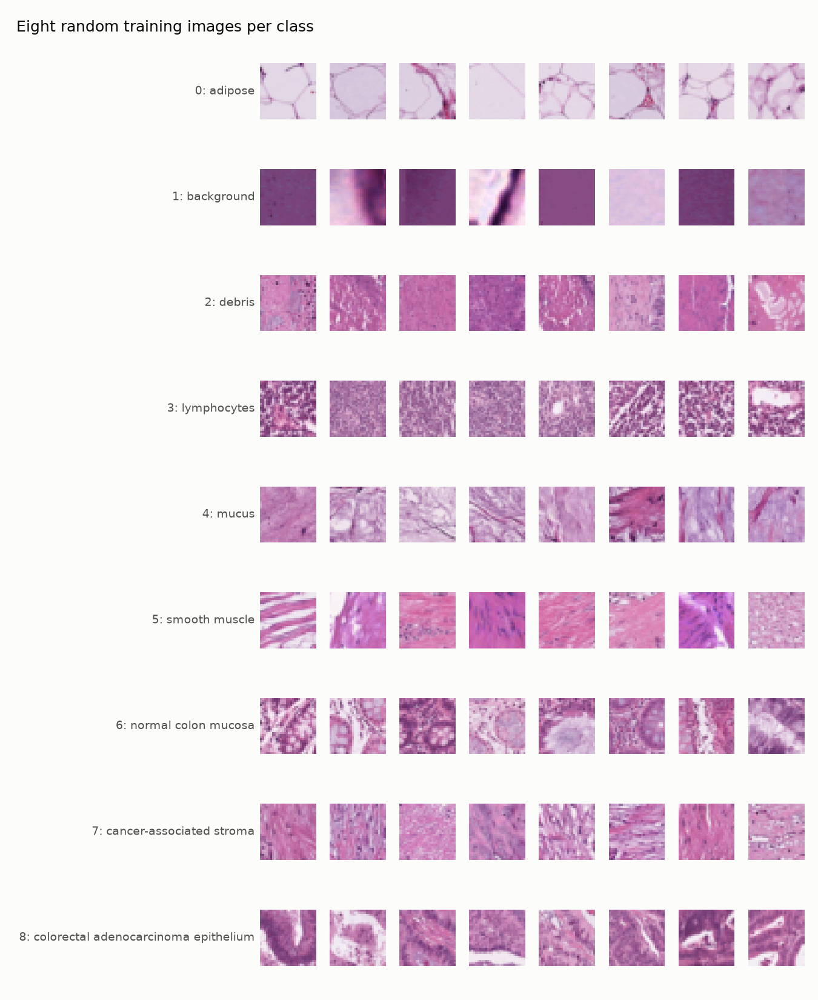
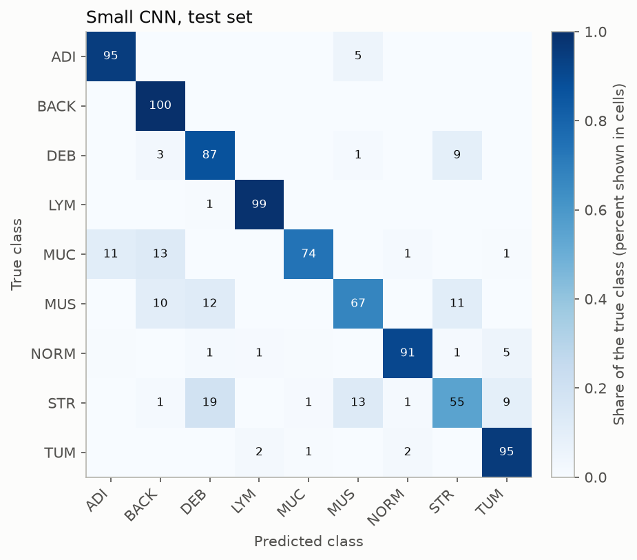
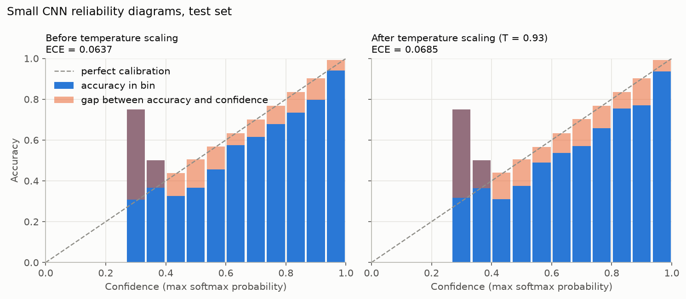
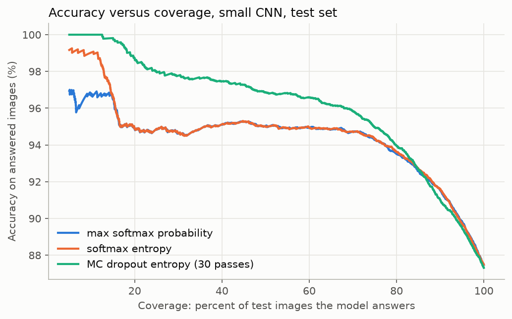
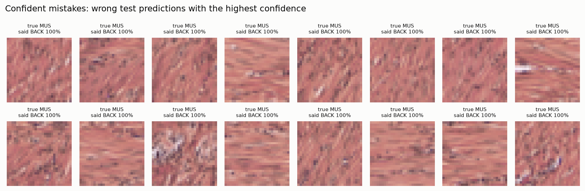
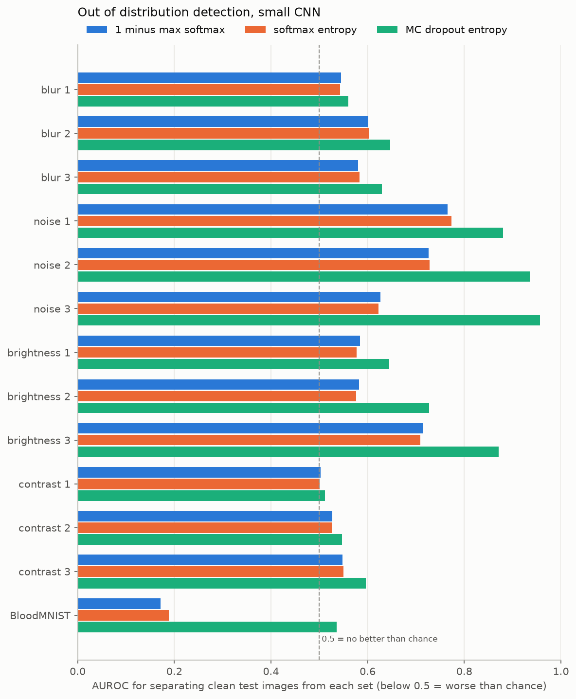
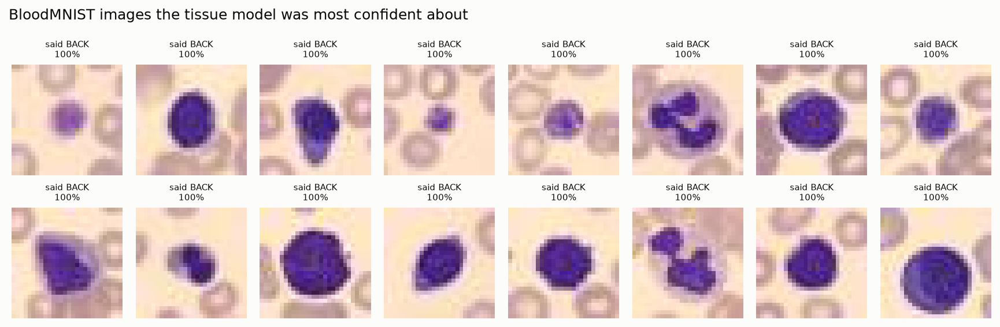
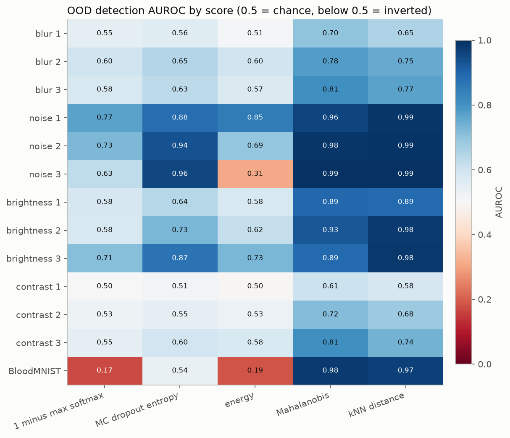
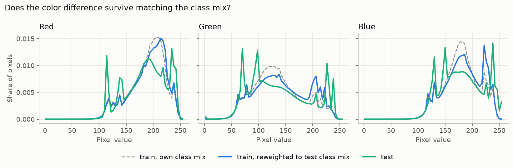
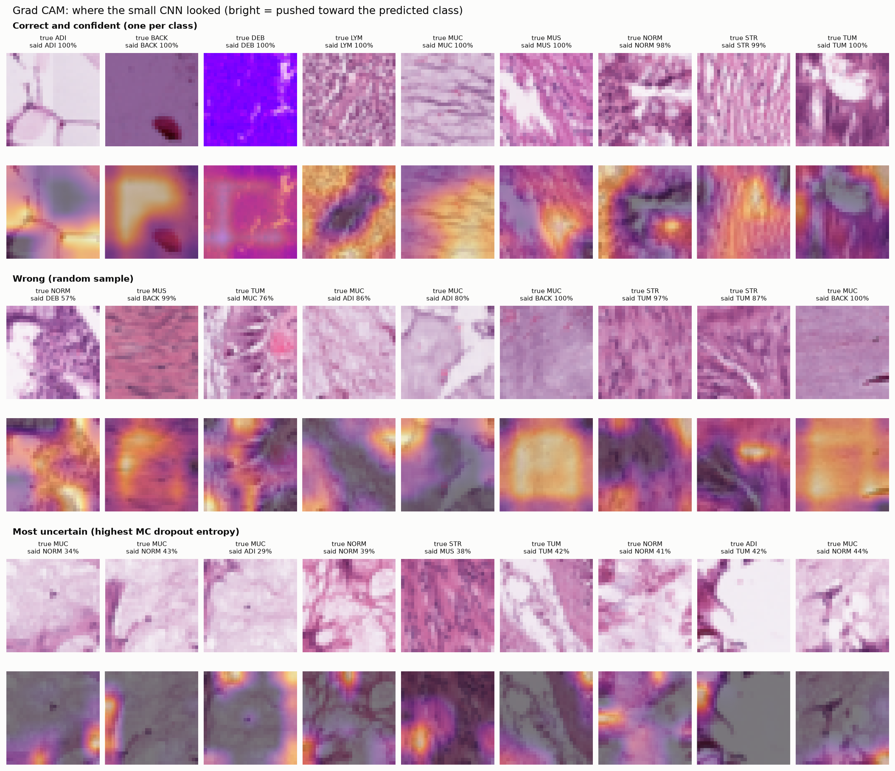

# Trustworthy Tissue Image Classifier

**Question:** can a tissue image classifier tell when it should not be trusted, especially on slides from a different hospital?

## Motivation

Deep learning models for digital pathology are usually developed on slides from one institution and then used on slides from others. Differences in staining chemistry, protocols, and scanners shift the appearance of the images, and a model can lose accuracy without becoming any less confident. For a model to be useful as a second reader, it should flag the cases where its answer is unreliable so that a pathologist knows when to look more closely. I set out to measure how well a simple tissue classifier does this.

## Results at a glance

* A small CNN reaches **0.875 test accuracy and 0.840 macro F1** on slides from an unseen clinical center, against 0.640 and 0.562 for the best flattened pixel baseline.
* Accuracy drops from 0.977 on in house validation data to 0.875 at the new center, and I trace the color shift to staining rather than class mix.
* Letting the model abstain on its least certain half of images raises accuracy to **0.969**, but its raw confidence is not reliable: it is overconfident at the new center and assigns over 90% confidence to 98.7% of blood cell images it should not recognize at all.
* Confidence based scores cannot detect those blood cell images (max softmax AUROC 0.17), but a Mahalanobis distance on the same network's penultimate features detects them with **AUROC 0.979** and a false positive rate of 0.4% at 95% true positive rate, without retraining.

A one page summary is in [`results/summary.md`](results/summary.md).

## Approach

**Data.** I used [PathMNIST](https://medmnist.com/) from the MedMNIST collection: 107,180 H&E stained colorectal tissue patches at 28 by 28 pixels in 9 classes (adipose, background, debris, lymphocytes, mucus, smooth muscle, normal mucosa, cancer associated stroma, and adenocarcinoma epithelium). I kept the official splits: 89,996 training and 10,004 validation images from one source (NCT CRC HE 100K) and 7,180 test images from a different clinical center (CRC VAL HE 7K). The test set therefore acts as an external validation set. The exploration notebook is `notebooks/00_explore_data.ipynb`.



**Baselines.** Logistic regression and a random forest on flattened pixels (2,352 features), both trained on the full training set, with the logistic regression regularization strength chosen on validation.

**Convolutional networks.** A small CNN (three convolution blocks and a dropout classifier head, 111,369 parameters) trained from scratch with flip and rotation augmentation and early stopping on validation loss, and an ImageNet pretrained ResNet18 fine tuned at 28 by 28. Both were trained on a laptop CPU.

**Trust analysis** of the small CNN:

* *Calibration:* expected calibration error (ECE) and reliability diagrams, before and after temperature scaling fitted on validation.
* *Selective prediction:* accuracy versus coverage using max softmax probability, softmax entropy, and Monte Carlo dropout entropy (30 stochastic passes).
* *Out of distribution detection:* AUROC and false positive rate at 95% true positive rate (FPR95) for separating clean test images from synthetically corrupted test images (blur, noise, brightness, contrast at three severities) and from BloodMNIST, a different imaging domain. I compare five scores computed from the same trained network: max softmax probability, Monte Carlo dropout entropy, energy, Mahalanobis distance on penultimate features, and k nearest neighbor distance in normalized feature space.
* *Stain shift analysis:* train versus test color histograms within each class, and with the training set reweighted to the test class mix.
* *Explainability:* Grad CAM heatmaps, checked against an untrained model and across classes.

## Results

### Classification

| Model | Test accuracy | Test macro F1 | Validation accuracy |
|---|---|---|---|
| Logistic regression (flattened pixels) | 0.574 | 0.448 | 0.527 |
| Random forest (flattened pixels) | 0.640 | 0.562 | 0.672 |
| **Small CNN** (from scratch, CPU) | **0.875** | **0.840** | 0.977 |
| ResNet18 (ImageNet pretrained, 4 CPU epochs) | 0.839 | 0.793 | 0.925 |

The table is generated from `results/metrics/` by `python -m src.compare`. Keeping the spatial layout is what matters: the small CNN raises normal mucosa recall from 0.25 (random forest) to 0.91. Its hardest classes on the external test set are cancer associated stroma (recall 0.55), smooth muscle (0.67), and mucus (0.74).



### Calibration

| | Validation ECE | Test ECE | Mean test confidence | Test accuracy |
|---|---|---|---|---|
| Small CNN | 0.003 | 0.064 | 0.938 | 0.875 |
| After temperature scaling (T = 0.93) | 0.003 | 0.069 | 0.942 | 0.875 |



### Selective prediction

| Uncertainty score | Accuracy at 50% coverage | 80% | 90% | 100% |
|---|---|---|---|---|
| Max softmax probability | 0.950 | 0.935 | 0.916 | 0.875 |
| Monte Carlo dropout entropy | **0.969** | **0.940** | 0.910 | 0.873 |

Monte Carlo dropout entropy also separates correct from incorrect predictions best (AUROC 0.828, against 0.774 for max softmax). Even so, 219 incorrect test predictions had confidence above 0.99; the most confident errors are smooth muscle predicted as background.





### Out of distribution detection

| Shifted data | Accuracy on it | AUROC, max softmax | AUROC, MC dropout entropy |
|---|---|---|---|
| Gaussian noise (severity 3) | 0.092 | 0.627 | **0.957** |
| Brightness (severity 3) | 0.089 | 0.714 | **0.871** |
| Blur (severity 3) | 0.295 | 0.580 | 0.629 |
| Contrast (severity 3) | 0.336 | 0.548 | 0.597 |
| BloodMNIST | not applicable | **0.172** | 0.536 |





### Feature space scores fix the BloodMNIST failure

To test whether stronger, standard detection scores fix the failure, I added three scores computed from the existing small CNN checkpoint, without retraining (`python -m src.ood`, under two minutes on CPU):

* **Energy** (Liu et al., 2020): the negative log sum exp of the logits.
* **Mahalanobis distance** (Lee et al., 2018): distance from the 128 dimensional penultimate features to the nearest class mean, with class means and one shared covariance fitted on training features only.
* **k nearest neighbor distance** (Sun et al., 2022): distance to the 50th nearest training feature after L2 normalization, fitted on training features only.

The in distribution set, corruptions, and BloodMNIST preprocessing are identical to the results above, and the max softmax and Monte Carlo dropout numbers reproduce exactly. The feature layer and k = 50 were fixed in advance, not tuned on the out of distribution sets. Full results for all 13 sets are in `results/metrics/ood_scores.csv`.

AUROC (FPR95 in parentheses; for FPR95, lower is better):

| Shifted data | Max softmax | MC dropout entropy | Energy | Mahalanobis | kNN distance |
|---|---|---|---|---|---|
| Blur (severity 3) | 0.580 (0.851) | 0.629 (0.752) | 0.571 (0.770) | **0.806** (0.592) | 0.768 (**0.447**) |
| Noise (severity 3) | 0.627 (0.910) | 0.957 (0.228) | 0.309 (1.000) | **0.993** (**0.000**) | 0.992 (0.001) |
| Brightness (severity 3) | 0.714 (0.925) | 0.871 (0.812) | 0.730 (0.608) | 0.888 (0.351) | **0.982** (**0.034**) |
| Contrast (severity 3) | 0.548 (0.922) | 0.597 (0.829) | 0.576 (0.860) | **0.806** (0.549) | 0.737 (**0.469**) |
| BloodMNIST | 0.172 (0.998) | 0.536 (0.997) | 0.186 (0.996) | **0.979** (**0.004**) | 0.968 (0.126) |



* **Mahalanobis distance fixes BloodMNIST:** AUROC rises from 0.172 to 0.979, and at the threshold that keeps 95% of real tissue images, only 0.4% of blood cell images get through (versus 99.8% with max softmax). kNN distance is close behind (AUROC 0.968).
* **Energy does not help.** It is computed from the same logits as max softmax and fails the same way on BloodMNIST (0.186), and it inverts on the strongest noise (0.309).
* **Feature distance scores are the best or near best on every set**, but mild shifts remain hard: the weakest contrast change reaches only 0.609 (Mahalanobis), and the mildest blur 0.699. Those images are still classified correctly 73% and 59% of the time, so they are not far from the training data.

**Hypothesis.** The classifier is confidently wrong on inputs far from its training data. An energy AUROC of 0.19 means that in about 81% of blood versus tissue pairs, the blood image produces *larger* logits (a higher log sum exp) than the real tissue image, almost always for "background". That is why max softmax and energy, both functions of the logits, rank blood cells as more familiar than tissue. This matches the known tendency of ReLU networks to produce high confidence far from the training data. The penultimate features still place blood cells far from every tissue class cluster, and the final linear layer discards that information when it maps features to class scores. Mahalanobis and kNN distance measure it directly. I have not tested this mechanism beyond these scores, so it remains a hypothesis.

### Stain shift

Reweighting the training images to the test class proportions leaves the train to test color distance essentially unchanged (total variation distance: red 0.173 to 0.171, green 0.186 to 0.196, blue 0.192 to 0.184). Within classes, the shift is largest for background (0.62) and adipose (0.45) and smallest for normal mucosa (0.07).



### Explainability

Grad CAM heatmaps from the trained model are uncorrelated with those from an untrained copy (median correlation −0.02 over 500 test images) and differ between the top two classes (−0.13), so they reflect learned, class specific evidence. For adipose they highlight cell walls, for lymphocytes clusters of nuclei, and for normal mucosa the tissue around glands. The highest confidence errors produce diffuse heatmaps covering the whole patch, consistent with a shortcut based on overall color and texture. The maps are computed on a 7 by 7 grid, so they are coarse.



## Key findings

* **A new hospital costs about 10 points, and the cause is staining.** Accuracy falls from 0.977 on validation to 0.875 on the external test set. Matching the class mix does not remove the color difference, so it reflects staining or scanning rather than which tissue types were sampled.
* **Calibration does not transfer.** The model is well calibrated in house (ECE 0.003) but overconfident at the new center (ECE 0.064). Temperature scaling fitted on validation finds nothing to correct and leaves test ECE slightly worse (0.069).
* **Abstaining on uncertain cases helps.** Answering only the most certain half of test images raises accuracy from 0.875 to 0.969 with Monte Carlo dropout entropy.
* **Confidence misses foreign images; feature distance catches them.** Max softmax AUROC on BloodMNIST is 0.17, meaning the model is more confident on blood cells than on real tissue, and energy is no better (0.19). A Mahalanobis distance on the penultimate features of the same network reaches 0.979 (FPR95 0.004), and also detects heavy noise (0.993). Mild blur and contrast changes remain hard for every score.

## Limitations

* Images are only 28 by 28 pixels, which removes most cell level detail.
* All data comes from one public dataset, with a single external test center.
* The images are stained H&E, not label free infrared chemical imaging, so the results do not transfer directly to that modality.
* ResNet18 is undertrained: it ran for 4 epochs on a CPU and was still improving, so its lower score does not show that pretrained models are worse for this task.
* Out of distribution data is either simulated (corruptions) or from a different domain (BloodMNIST), not real acquisition failures. BloodMNIST is a very distant domain, so the strong Mahalanobis result there may not carry over to subtler real problems, where all scores were weaker (best AUROC 0.61 on mild contrast loss).
* The feature distance scores have one configuration each (penultimate layer, k = 50), evaluated on a single trained network; the explanation for why they succeed is a hypothesis, not a tested mechanism.
* Each model was trained once, so there are no error bars across seeds.

## Next steps

* Train ResNet18 for longer on a GPU, at 64 by 64 or 224 by 224.
* Add stain normalization or color augmentation and measure whether the validation to test gap shrinks.
* Compare deep ensembles and dropout in the convolution layers against head only Monte Carlo dropout.
* Use the Mahalanobis score as an input check that rejects images that are not tissue, and test it on real acquisition artifacts (folds, pen marks, out of focus regions) and on subtler domain shifts.
* Test the hypothesis directly, for example by comparing logit magnitudes and feature distances across layers for blood and tissue images.
* Repeat all runs over several seeds.

## How to reproduce

Requires Python 3.12 and git.

```bash
git clone https://github.com/anshulsin15jn-boop/trustworthy_tissue_classifier.git
cd trustworthy_tissue_classifier

# Windows (PowerShell):
py -3.12 -m venv .venv
.venv\Scripts\activate
# macOS/Linux:
python3.12 -m venv .venv
source .venv/bin/activate

pip install -r requirements.txt
python -m pytest            # downloads PathMNIST (about 200 MB) on the first run
```

Each stage runs from the project root. Times are from a 16 core laptop CPU.

```bash
python -m src.baselines                      # baselines, about 3 minutes
python -m src.train --model small_cnn        # small CNN, about 22 minutes (overwrites the committed checkpoint)
python -m src.train --model resnet18 --lr 0.0005 --max-epochs 5 --patience 2 --max-minutes 25
python -m src.compare                        # comparison table
python -m src.stain                          # stain shift analysis, about 1 minute
python -m src.trust                          # calibration, uncertainty, OOD (downloads BloodMNIST)
python -m src.ood                            # five OOD scores, about 2 minutes
python -m src.explain                        # Grad CAM, under a minute
```

The trust and explainability stages only need the committed small CNN checkpoint (`checkpoints/small_cnn.pt`, 0.46 MB), so they reproduce the reported numbers without retraining. Retraining on other hardware may give slightly different numbers because CPU arithmetic is not fully deterministic. Run logs are in `results/logs/`.

### Engineering notes

* Training stores images as 8 bit integers and normalizes per batch, computes channel statistics in chunks, and uses `num_workers=0`. Peak RAM was 1.14 GB for the small CNN and 1.04 GB for ResNet18.
* Logistic regression is fit with full batch `L-BFGS` in PyTorch, minimizing the same objective as scikit learn's `LogisticRegression`, because scikit learn's solver did not converge in reasonable time on 2,352 features. `tests/test_baselines.py` checks that the two agree.

### Project layout

```
src/
  data.py       data loading, tensors, augmentation, corruptions
  baselines.py  logistic regression and random forest
  models.py     small CNN and ResNet18, checkpoints
  train.py      training with early stopping, test evaluation
  evaluate.py   accuracy, macro F1, per class metrics, confusion matrices
  compare.py    model comparison table
  trust.py      calibration, selective prediction, OOD detection
  ood.py        energy, Mahalanobis, and kNN OOD scores
  stain.py      stain shift versus class mix analysis
  explain.py    Grad CAM and sanity checks
  plotting.py   shared plot style
notebooks/      data exploration
results/        metrics, figures, run logs, summary.md
checkpoints/    small_cnn.pt
tests/          pytest tests
```

## Credits

* **MedMNIST** (PathMNIST and BloodMNIST): Yang et al., *Scientific Data*, 2023, [doi:10.1038/s41597-022-01721-8](https://doi.org/10.1038/s41597-022-01721-8). Released under CC BY 4.0.
* **Original colorectal histology data** (NCT CRC HE 100K and CRC VAL HE 7K): Kather et al., *PLOS Medicine*, 2019, [doi:10.1371/journal.pmed.1002730](https://doi.org/10.1371/journal.pmed.1002730).
* **Original blood cell data** behind BloodMNIST: Acevedo et al., *Data in Brief*, 2020, [doi:10.1016/j.dib.2020.105474](https://doi.org/10.1016/j.dib.2020.105474).

* **Detection methods:** Mahalanobis distance, Lee et al., NeurIPS 2018 ([arXiv:1807.03888](https://arxiv.org/abs/1807.03888)); energy score, Liu et al., NeurIPS 2020 ([arXiv:2010.03759](https://arxiv.org/abs/2010.03759)); k nearest neighbor distance, Sun et al., ICML 2022 ([arXiv:2204.06507](https://arxiv.org/abs/2204.06507)).

## Built with

Python, PyTorch, and scikit learn, with Claude Code as a coding assistant.
