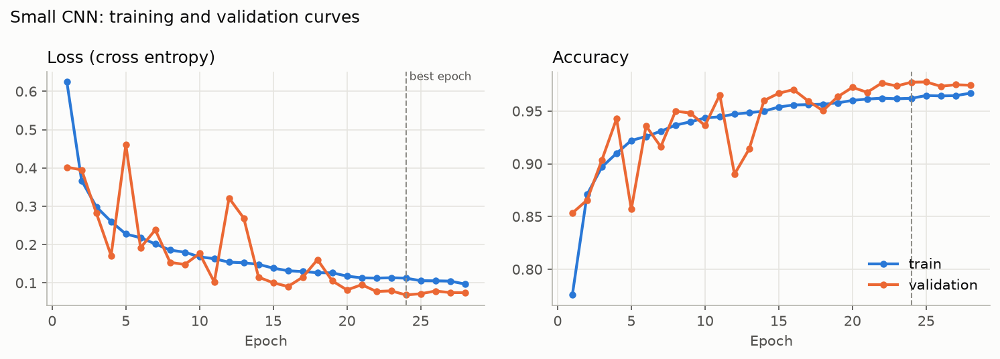
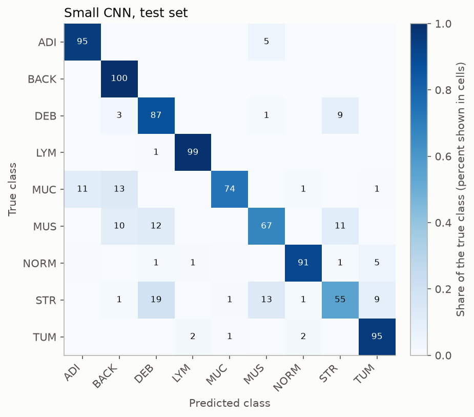
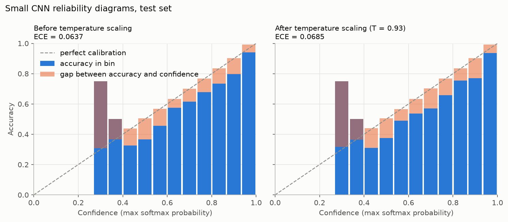
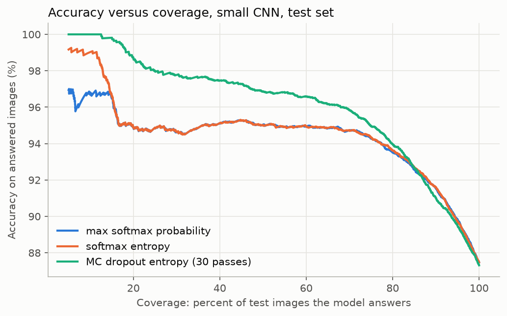
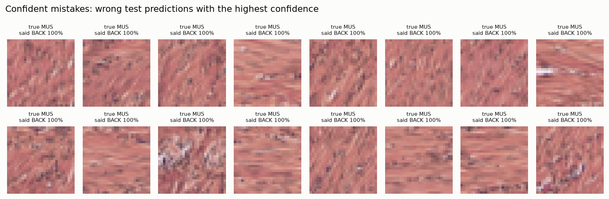
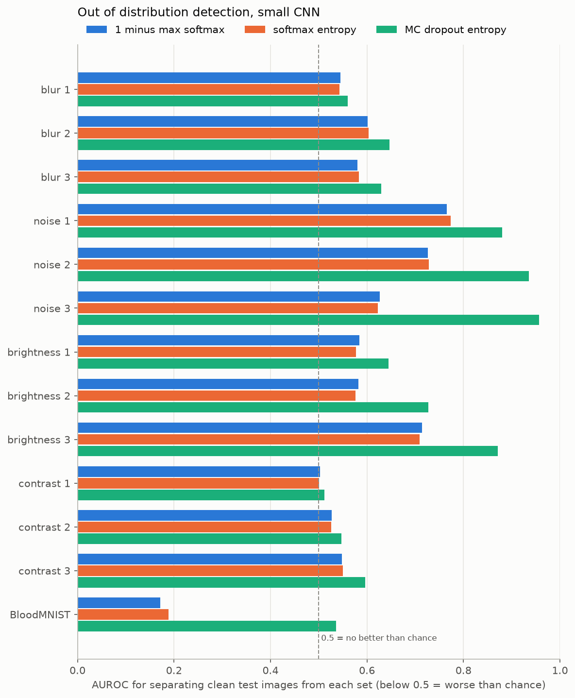
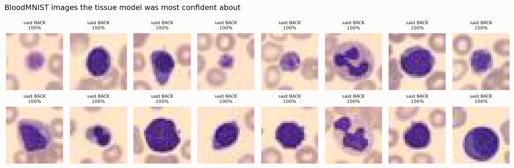
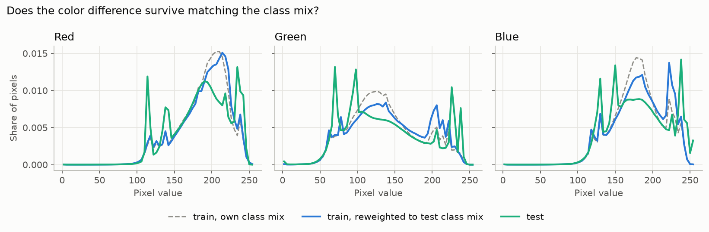

# Trustworthy Tissue Image Classifier

A tissue image classifier that flags when it is unsure or seeing unfamiliar data, so a pathologist would know when to double check it.

## The question

Medical image classifiers can be accurate on average and still be confidently wrong on individual images, especially images that look different from their training data. This project trains classifiers on colon tissue images and then asks how far the model can be trusted: does it know when it does not know?

## The data

[PathMNIST](https://medmnist.com/) from the MedMNIST collection: 107,180 patches of H&E stained colorectal cancer tissue, each 28 by 28 pixels, in 9 tissue classes. The official splits are 89,996 training, 10,004 validation, and 7,180 test images. The test images come from a different clinical center than the training images. See `notebooks/00_explore_data.ipynb` for the class balance, example images, and pixel statistics.


### What we learned from the data

* **The training classes are fairly balanced.** The most common class (adenocarcinoma epithelium, 14.3%) is only about 1.6 times as common as the least common (normal colon mucosa, 8.8%). We still report macro F1 and per class recall, which weigh every class equally.
* **The "background" class is not just empty glass.** Many background patches are dark, blurry, or edge regions of the slide. Some could be mistaken for dense purple tissue such as lymphocytes.
* **The test set differs from the training set in two ways at once.** It comes from a different clinical center, and its pixel colors are more spread out. It also has a different mix of classes: 18.6% of test images are adipose (fat) versus 10.4% in training. Adipose patches are mostly pale, so the class mix alone shifts the color statistics. Our color histograms therefore cannot tell us how much of the difference is staining and how much is class mix.
* **Validation looks like training, not like test.** Validation was cut from the same source as training, so a model may score higher on validation than on test. That gap is something to watch in later phases.

## Methods by phase

| Phase | What | Status |
|---|---|---|
| 0 | Setup and data exploration | done |
| 1 | Baselines: logistic regression, random forest | done |
| 2 | Small CNN and pretrained ResNet18, both trained on CPU | done |
| 3 | Trust: calibration, uncertainty, out of distribution detection, staining check | done |
| 4 | Explainability with Grad CAM, writeup | planned |

## Results

Filled in as each phase finishes. Every number here comes from code in this repo.

### Phase 1: baselines on flattened pixels

Both models see each image as 2,352 unordered numbers and were trained on all 89,996 training images. Logistic regression's regularization strength was chosen on the validation set. Run `python -m src.baselines`; the log is in `results/logs/baselines.txt`.

| Model | Test accuracy | Test macro F1 | Validation accuracy |
|---|---|---|---|
| Logistic regression (C = 0.0001) | 0.574 | 0.448 | 0.527 |
| Random forest (200 trees) | 0.640 | 0.562 | 0.672 |

What we learned:

* **Flattened pixels only get you so far.** Background (100% recall for the random forest) and adipose are easy because their overall color is distinctive. Classes defined by texture and structure are hard.
* **Normal mucosa is the worst case.** The random forest finds only 25% of normal mucosa and calls 48% of it tumor; logistic regression finds only 7%. A model that calls healthy tissue cancer is exactly the kind of error a pathologist needs flagged.
* **Accuracy and macro F1 can move in opposite directions.** Logistic regression scores higher accuracy on test than on validation (0.574 versus 0.527) but lower macro F1 (0.448 versus 0.480). The test set contains more of the easy adipose class, which lifts accuracy without the model being better at the hard classes.
* **Why a CNN should help:** flattening throws away which pixels are next to each other, so a model cannot learn "a ring of purple nuclei around a pale gland." A convolutional network keeps the 2D layout and learns small local patterns.


### Phase 2: convolutional neural networks

All four models on the same official test set (`python -m src.compare` rebuilds this table from `results/metrics/`):

| Model | Test accuracy | Test macro F1 | Validation accuracy |
|---|---|---|---|
| Logistic regression (flattened pixels) | 0.574 | 0.448 | 0.527 |
| Random forest (flattened pixels) | 0.640 | 0.562 | 0.672 |
| **Small CNN** (trained from scratch, CPU) | **0.875** | **0.840** | 0.977 |
| ResNet18 (ImageNet pretrained, fine tuned on CPU) | 0.839 | 0.793 | 0.925 |

* **Small CNN:** three convolution blocks and a dropout classifier, 111,369 parameters. Trained with random flips and 90 degree rotations, Adam, batch size 128, and early stopping on validation loss (patience 4). It stopped after 28 epochs and kept epoch 24. Training took 22.1 minutes on a laptop CPU with a peak of 1.14 GB of RAM. Log: `results/logs/small_cnn.txt`.
* **ResNet18:** ImageNet weights with a new 9 class output layer, fine tuned at 28 by 28. Each epoch took about 6 to 8 minutes on the CPU, so it ran under a 25 minute budget: 4 epochs, keeping epoch 3. Peak RAM was 1.04 GB. Log: `results/logs/resnet18.txt`.

What we learned:

* **Keeping the 2D layout is what matters.** The small CNN beats the random forest by 23.5 points of accuracy and 0.28 of macro F1. Normal mucosa recall rose from 25% to 91%.
* **The pretrained ResNet18 did not win here.** Two likely reasons: it trained for only 4 epochs against the small CNN's 28, and its design shrinks a 28 by 28 input to a single cell by the last block, far from the 224 by 224 photos it was pretrained on. This is a result about this setup, not about transfer learning in general.
* **There is a big gap between validation and test.** The small CNN reaches 0.977 on validation but 0.875 on test. Validation comes from the same source as training; test comes from another clinical center. A model can look nearly perfect in house and still drop 10 points at a new hospital.
* **The hardest classes on test** are cancer associated stroma (55% recall, often called debris or smooth muscle), smooth muscle (67%), and mucus (74%, sometimes called background or adipose).





## Trust

Phase 3 asks whether the small CNN knows when it does not know. Run `python -m src.trust` and `python -m src.stain`; all numbers are in `results/metrics/trust.json` and `results/metrics/stain.json`.

### Calibration: does 90 percent confidence mean 90 percent right?

| | Validation ECE | Test ECE | Mean confidence on test | Test accuracy |
|---|---|---|---|---|
| Small CNN | 0.003 | 0.064 | 0.938 | 0.875 |
| Small CNN after temperature scaling (T = 0.93) | 0.003 | 0.069 | 0.942 | 0.875 |

* **In house, the model is almost perfectly calibrated** (ECE 0.003 on validation). **At the new hospital it is overconfident**: about 6 points more confident than it is accurate.
* **Temperature scaling did not help.** It is fitted on validation data, where there was nothing to fix, so it learned T = 0.93 (slightly sharper) and made test calibration a little worse. A calibration fix learned on in house data cannot anticipate a shift it has never seen. (For ResNet18, using the local checkpoint, temperature scaling did lower test ECE slightly, from 0.078 to 0.071.)



### Uncertainty: can the model hand its hardest cases to a pathologist?

| Uncertainty score | Accuracy if the model answers its most certain 50% | 80% | 90% | All |
|---|---|---|---|---|
| Max softmax probability | 0.950 | 0.935 | 0.916 | 0.875 |
| Monte Carlo dropout entropy (30 passes) | **0.969** | **0.940** | 0.910 | 0.873 |

* **Refusing uncertain images works.** If the model answers only its most certain half, accuracy rises from 87.5% to 95.0% with max softmax and 96.9% with Monte Carlo dropout.
* **Monte Carlo dropout separates right from wrong answers best**: AUROC 0.828, against 0.774 for max softmax probability. Its advantage is at low and middle coverage; at 90% coverage the two are about equal.
* **Some mistakes are invisible to confidence:** 219 wrong test predictions had more than 99% confidence. The most confident ones are all smooth muscle called background at 100%.





### Out of distribution detection: does the model notice unfamiliar images?

AUROC for telling clean test images apart from each kind of unfamiliar data (0.5 is chance, 1.0 is perfect):

| Unfamiliar data | Accuracy on it | Max softmax | Monte Carlo dropout entropy |
|---|---|---|---|
| Gaussian noise (strongest) | 0.092 | 0.627 | **0.957** |
| Brightness (strongest) | 0.089 | 0.714 | **0.871** |
| Blur (strongest) | 0.295 | 0.580 | 0.629 |
| Contrast (strongest) | 0.336 | 0.548 | 0.597 |
| BloodMNIST (blood cells, not tissue) | not applicable | **0.172** | 0.536 |

* **Corruptions wreck accuracy while confidence stays high.** Under noise, accuracy falls to about 9%, which is chance for 9 classes, yet mean confidence stays between 0.79 and 0.89.
* **Monte Carlo dropout catches noise and brightness changes well** (AUROC up to 0.96). Max softmax catches them only weakly, and neither catches faded contrast or blur.
* **BloodMNIST is a complete failure.** The tissue model calls 98% of blood cell images "background", and 98.7% of them get over 90% confidence. Max softmax AUROC is 0.17, worse than chance: the model is *more* confident on blood cells than on real tissue. Monte Carlo dropout only brings this to 0.54, close to chance. A softmax classifier has no "none of the above" option, so data from a different domain can land confidently in whichever class it most resembles.





### Is the test set's color different because of staining or because of class mix?

Phase 0 could not separate the two. Here the training set is reweighted to the test set's exact class mix. The color distance between train and test barely moves (red 0.173 to 0.171, green 0.186 to 0.196, blue 0.192 to 0.184, on a scale where 0 is identical and 1 is no overlap). **The difference is in the images themselves, not the class mix:** a real staining or scanning shift. Within single classes it is largest for background (0.62) and adipose (0.45) and smallest for normal mucosa (0.07).



### What worked and what did not

* **Worked:** Monte Carlo dropout entropy is the most useful flag. It raises accuracy on the cases the model keeps and detects noise and exposure problems well.
* **Did not work:** temperature scaling fitted in house did not fix overconfidence at a new hospital, contrast and blur changes were mostly undetected, and blood cell images, a different domain entirely, were not flagged at all.
* **The takeaway for a pathologist:** high confidence from this model is not a guarantee. Uncertainty flags catch some problems, but a separate check that an image is even tissue is needed before trusting any prediction.

## Limitations

To be written. Known so far: images are only 28 by 28 pixels, and all data comes from one public dataset.

## How to reproduce

Requires Python 3.12 and git. Name the Python version explicitly when creating the environment, because plain `python` may point to a different version on your machine.

```bash
git clone https://github.com/anshulsin15jn-boop/trustworthy_tissue_classifier.git
cd trustworthy_tissue_classifier

# Windows (PowerShell):
py -3.12 -m venv .venv
.venv\Scripts\activate
# macOS/Linux:
python3.12 -m venv .venv
source .venv/bin/activate

python --version            # should print Python 3.12.x
pip install -r requirements.txt
python -m pytest            # downloads PathMNIST (about 200 MB) on the first run
jupyter notebook notebooks/00_explore_data.ipynb
```

## Engineering notes

* **Memory:** the first small CNN run was stopped when the laptop ran low on memory. Training now keeps images as 8 bit integers and normalizes one batch at a time, computes channel statistics in chunks, and uses a single process DataLoader (`num_workers=0`). Peak RAM fell to 1.14 GB for the small CNN and 1.04 GB for ResNet18, logged in each run.
* **Logistic regression** is fit with full batch L-BFGS in PyTorch, minimizing the same objective as scikit learn's `LogisticRegression`. scikit learn's own solver did not converge in reasonable time on 2,352 features; `tests/test_baselines.py` checks that the two agree.
* **Checkpoints:** the small CNN checkpoint (0.46 MB) is committed so Phases 3 and 4 use exactly the model reported here. The ResNet18 checkpoint (45 MB) is not committed.

## Project layout

```
src/          reusable code (data loading now, models and evaluation later)
notebooks/    exploration and Colab notebooks
results/      saved metrics and figures
tests/        pytest tests
data/         downloaded datasets (not committed)
```
