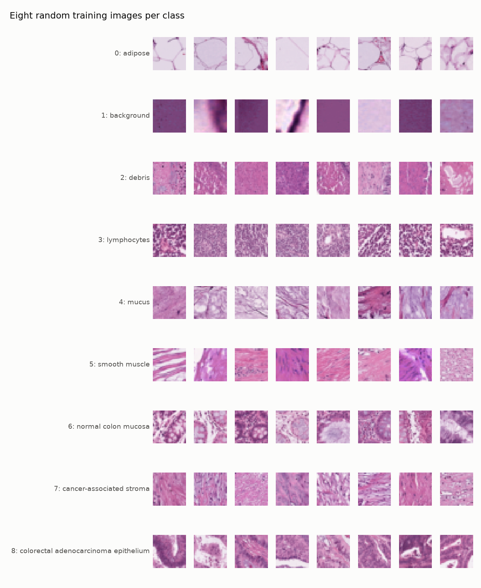
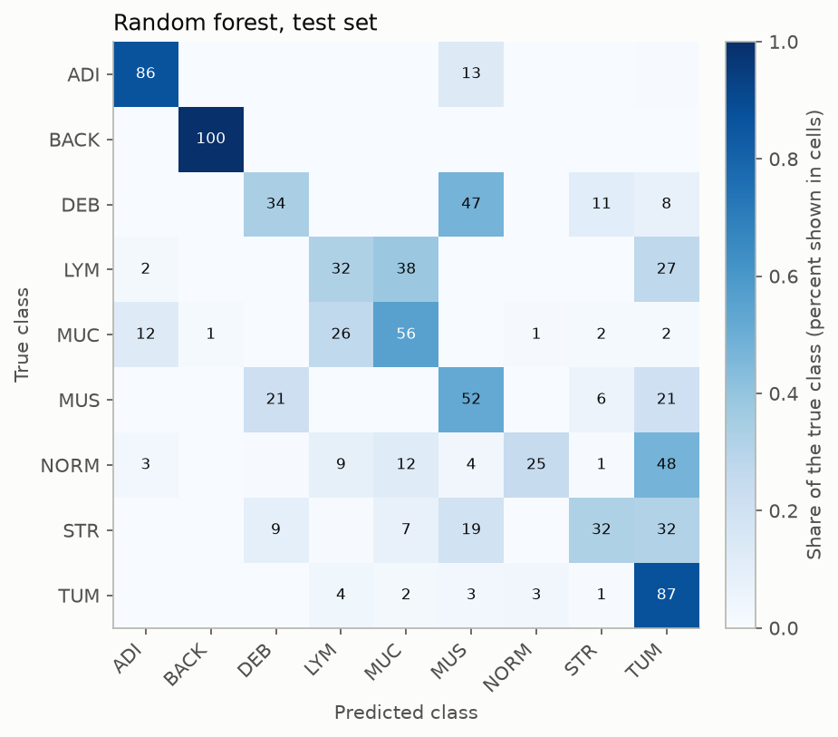

# Trustworthy Tissue Image Classifier

A tissue image classifier that flags when it is unsure or seeing unfamiliar data, so a pathologist would know when to double check it.

## The question

Medical image classifiers can be accurate on average and still be confidently wrong on individual images, especially images that look different from their training data. This project trains classifiers on colon tissue images and then asks how far the model can be trusted: does it know when it does not know?

## The data

[PathMNIST](https://medmnist.com/) from the MedMNIST collection: 107,180 patches of H&E stained colorectal cancer tissue, each 28 by 28 pixels, in 9 tissue classes. The official splits are 89,996 training, 10,004 validation, and 7,180 test images. The test images come from a different clinical center than the training images. See `notebooks/00_explore_data.ipynb` for the class balance, example images, and pixel statistics.



### What we learned from the data

* **The training classes are fairly balanced.** The most common class (adenocarcinoma epithelium, 14.3%) is only about 1.6 times as common as the least common (normal colon mucosa, 8.8%). We still report macro F1 and per class recall, which weigh every class equally.
* **The "background" class is not just empty glass.** Many background patches are dark, blurry, or edge regions of the slide. Some could be mistaken for dense purple tissue such as lymphocytes.
* **The test set differs from the training set in two ways at once.** It comes from a different clinical center, and its pixel colors are more spread out. It also has a different mix of classes: 18.6% of test images are adipose (fat) versus 10.4% in training. Adipose patches are mostly pale, so the class mix alone shifts the color statistics. Our color histograms therefore cannot tell us how much of the difference is staining and how much is class mix.
* **Validation looks like training, not like test.** Validation was cut from the same source as training, so a model may score higher on validation than on test. That gap is something to watch in later phases.

## Methods by phase

| Phase | What | Status |
|---|---|---|
| 0 | Setup and data exploration | done |
| 1 | Baselines: logistic regression, random forest | done |
| 2 | Small CNN on CPU, pretrained ResNet18 on Colab | planned |
| 3 | Trust: calibration, uncertainty, out of distribution detection | planned |
| 4 | Explainability with Grad CAM, writeup | planned |

## Results

Filled in as each phase finishes. Every number here comes from code in this repo.

### Phase 1: baselines on flattened pixels

Both models see each image as 2,352 unordered numbers and were trained on all 89,996 training images. Logistic regression's regularization strength was chosen on the validation set. Run `python -m src.baselines`; the log is in `results/logs/baselines.txt`.

| Model | Test accuracy | Test macro F1 | Validation accuracy |
|---|---|---|---|
| Logistic regression (C = 0.0001) | 0.574 | 0.448 | 0.527 |
| Random forest (200 trees) | 0.640 | 0.562 | 0.672 |

What we learned:

* **Flattened pixels only get you so far.** Background (100% recall for the random forest) and adipose are easy because their overall color is distinctive. Classes defined by texture and structure are hard.
* **Normal mucosa is the worst case.** The random forest finds only 25% of normal mucosa and calls 48% of it tumor; logistic regression finds only 7%. A model that calls healthy tissue cancer is exactly the kind of error a pathologist needs flagged.
* **Accuracy and macro F1 can move in opposite directions.** Logistic regression scores higher accuracy on test than on validation (0.574 versus 0.527) but lower macro F1 (0.448 versus 0.480). The test set contains more of the easy adipose class, which lifts accuracy without the model being better at the hard classes.
* **Why a CNN should help:** flattening throws away which pixels are next to each other, so a model cannot learn "a ring of purple nuclei around a pale gland." A convolutional network keeps the 2D layout and learns small local patterns.



## Trust

To be written in Phase 3.

## Limitations

To be written. Known so far: images are only 28 by 28 pixels, and all data comes from one public dataset.

## How to reproduce

Requires Python 3.12 and git. Name the Python version explicitly when creating the environment, because plain `python` may point to a different version on your machine.

```bash
git clone https://github.com/anshulsin15jn-boop/trustworthy_tissue_classifier.git
cd trustworthy_tissue_classifier

# Windows (PowerShell):
py -3.12 -m venv .venv
.venv\Scripts\activate
# macOS/Linux:
python3.12 -m venv .venv
source .venv/bin/activate

python --version            # should print Python 3.12.x
pip install -r requirements.txt
python -m pytest            # downloads PathMNIST (about 200 MB) on the first run
jupyter notebook notebooks/00_explore_data.ipynb
```

## Project layout

```
src/          reusable code (data loading now, models and evaluation later)
notebooks/    exploration and Colab notebooks
results/      saved metrics and figures
tests/        pytest tests
data/         downloaded datasets (not committed)
```
